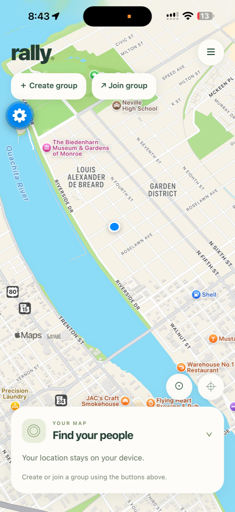

# Rally

**Live location sharing for the people you're actually with.**

Rally is a full-stack, real-time location app. You create a group for a road trip, a hike, or a night out, share an invite code, and everyone who joins sees each other move on a live map. It's like "share my location," but only the people in your group can see you.

I built the whole thing myself: three Go microservices that talk over gRPC, an HTTP/WebSocket API gateway, Postgres and Redis behind them, and a React Native mobile app on top.

<p align="center">
  
</p>

---

## How Rally works

1. **Sign up and log in.** The Auth service hashes your password with bcrypt and gives you a JWT. The app keeps that token in the phone's secure storage, so you stay logged in.
2. **Create or join a group.** The Group service makes the group and an invite code. Friends type in the code to join. Group stores only user IDs and asks Auth for display names, so user data lives in one place.
3. **Share your location.** The app opens a WebSocket to the gateway and sends your coordinates. The gateway checks your JWT and passes the updates to the Location service over a two-way gRPC stream.
4. **Check membership.** Before Location accepts any updates, it asks Group whether you belong to that group. People outside the group can't send or see locations.
5. **Send to everyone in the group.** Location saves your latest position in Redis and publishes it to the group's Redis pub/sub channel. Every other member's connection listens on that channel, so their maps move right away. Nobody has to refresh.

```
                 ┌──────────────────────────────┐
                 │  React Native app (Expo, TS) │
                 └──────────────┬───────────────┘
                     HTTPS/JSON │  WebSocket
                 ┌──────────────▼───────────────┐
                 │   API Gateway (Go + Gin)     │
                 │   JWT auth · WS ↔ gRPC relay │
                 └───┬──────────┬───────────┬───┘
                gRPC │     gRPC │      gRPC │ (bidi stream)
              ┌──────▼──┐  ┌────▼────┐  ┌───▼──────┐
              │  Auth   │◄─┤  Group  │◄─┤ Location │
              └────┬────┘  └────┬────┘  └────┬─────┘
                   ▼            ▼            ▼
               Postgres     Postgres       Redis
                                       (pub/sub + cache)
```

Each service owns its own data and follows the same layers: `handler → service → repository`. The gateway is the only part the phone talks to, so the internal gRPC services are never exposed directly. Because Redis passes the updates between servers, more copies of the Location service can run side by side, and everyone in a group still sees each other.

## Tech stack

| Layer | Tools |
|---|---|
| **Mobile app** | React Native, Expo, TypeScript, React Navigation, react-native-maps (Google Maps / Apple Maps), expo-location, expo-secure-store |
| **Backend services** | Go, gRPC, Protocol Buffers |
| **API gateway** | Go, Gin, Gorilla WebSocket |
| **Databases** | PostgreSQL 16 (pgx, goose migrations), Redis 7 (pub/sub and latest-position cache) |
| **Auth** | JWT (golang-jwt), bcrypt, gRPC auth interceptors |
| **Infrastructure** | Docker, Docker Compose, Make |

---

Built by [Saugat Adhikari](https://github.com/adk-saugat).
